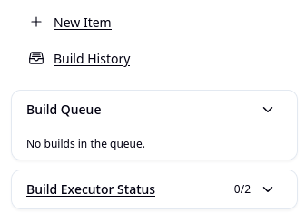
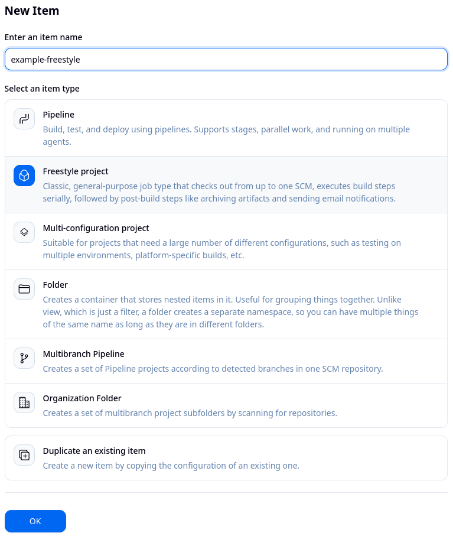
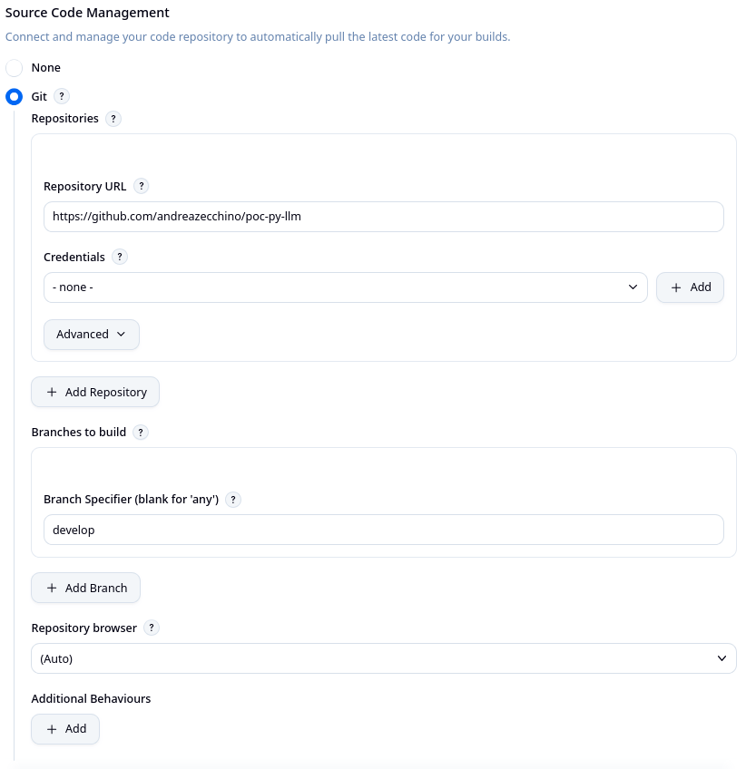
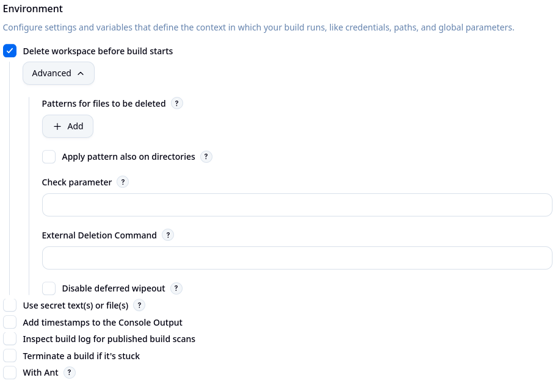
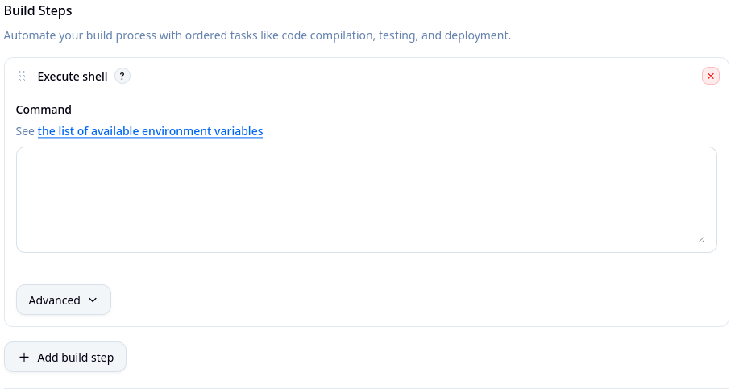
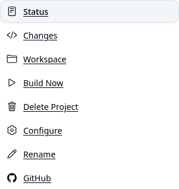
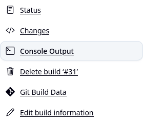

# Create a Freestyle project

1. Login and select **New Item** from the Jenkins Dashboard. <p align="left"></p>

2. Select **Freestyle project**, choose the name for your project then click **OK** at the end of the page to open the configuration page. <p align="left"></p>

3. In **Source Code Management** section, choose a Git repository and a branch where to pull the latest code for your builds. For this learning path, I chose a small Python project that I worked on. <p align="left"></p>

4. In **Environment** section, the workspace will be cleaned up before each run. <p align="left"></p>

5. In **Build Steps**, a security scan of the code will be performed using the shell and **Trivy**. <p align="left"></p>
```bash
# Paste those commands in the textarea
docker pull aquasec/trivy
docker run -v ${WORKSPACE}:/app aquasec/trivy \
  fs \
  --severity HIGH,CRITICAL \
  --scanners vuln,secret,misconfig \
  --ignore-unfixed \
  --exit-code 1 \
  /app
```

6. Click **Save** to open the project view page. On this page, click **Build Now** to start the process. Under **Builds** it's possible to access the details for this particular run. <p align="left"></p>

7. Click **Console Output** to see the output of the process. <p align="left"></p>

