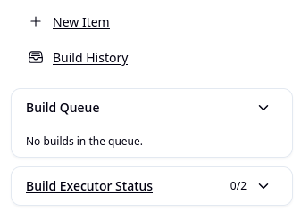
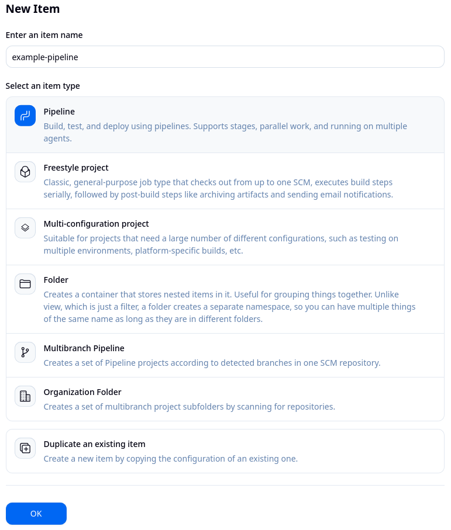
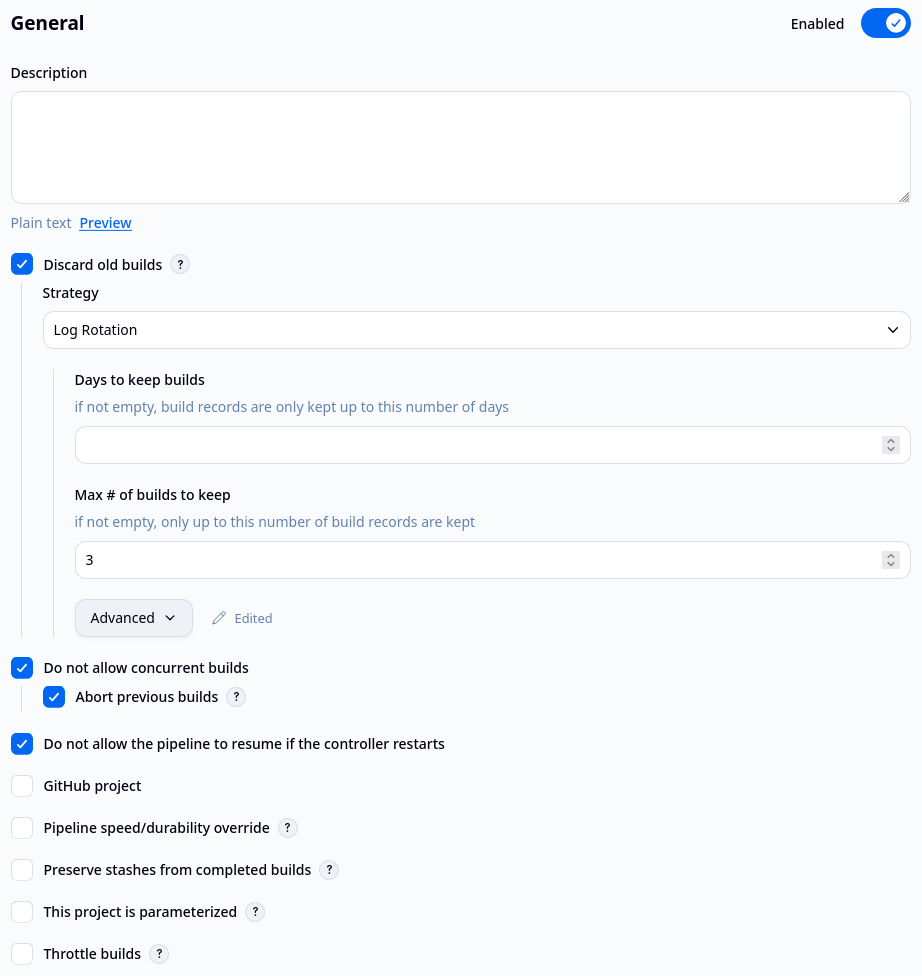
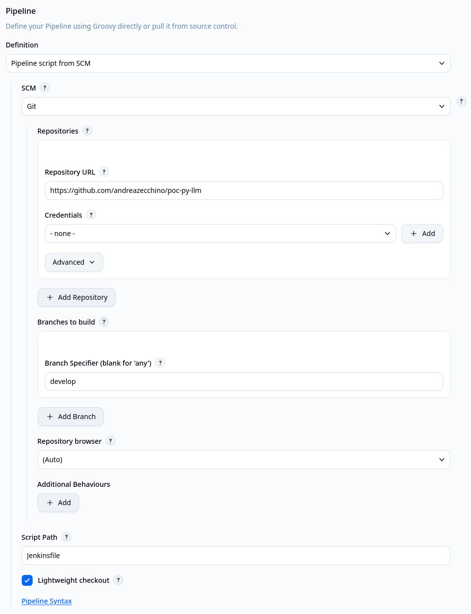
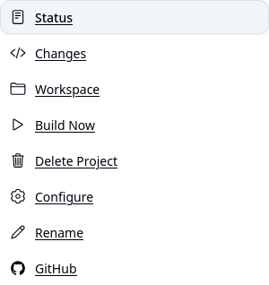
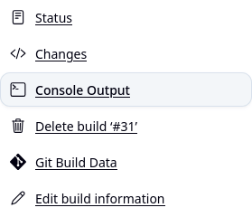

# Create a Pipeline

1. Login and select **New Item** from the Jenkins Dashboard. <p align="left"></p>

2. Select **Pipeline**, choose the name for your project then click **OK** at the end of the page to open the configuration page. <p align="left"></p>

3. In **General** section, apply a max number of builds to keep, prevent concurrent builds and deny pipeline resume it the controller restarts. <p align="left"></p>

4. From the **Definition** field in **Pipeline** section, choose the **Pipeline script from SCM** option. Choose a Git repository and a branch where to pull the latest code for your builds. For this learning path, I chose a small Python project that I worked on. <p align="left"></p>
This is the [Jenkinsfile](Jenkinsfile) used.
```groovy
pipeline {
    agent any
    stages {
        stage('Lint & Unit tests') {
            agent {
                docker {
                    image 'ghcr.io/astral-sh/uv:python3.14-trixie-slim'
                    reuseNode true
                }
            }
            environment {
                UV_CACHE_DIR = "${env.WORKSPACE}/.uv-cache"
                UV_TOOL_DIR = "${env.WORKSPACE}/.uv-tools"
            }
            steps {
                sh 'uv sync --locked'
                sh 'uv run ruff check .'
                sh 'uv run ruff format --check .'
                sh 'uv run python -m unittest discover -s tests -p "test_*.py" -v'
            }
        }
        stage('Security Scan') {
            agent {
                docker {
                    image 'aquasec/trivy:0.76.1'
                    args '--entrypoint=""'
                    reuseNode true
                }
            }
            steps {
                sh '''
                    trivy fs \
                      --cache-dir memory \
                      --severity HIGH,CRITICAL \
                      --scanners vuln,secret,misconfig \
                      --ignore-unfixed \
                      --exit-code 1 \
                      --format json \
                      --output trivy-fs-report.json \
                      "$WORKSPACE"
                '''
            }
        }
    }
    post {
        always {
            archiveArtifacts allowEmptyArchive: true, artifacts: 'trivy-*.json', fingerprint: true, followSymlinks: false
        }
    }
}
```

5. Click **Save** to open the project view page. On this page, click **Build Now** to start the process. Under **Builds** it's possible to access the details for this particular run. <p align="left"></p>

6. Click **Console Output** to see the output of the process. <p align="left"></p>
